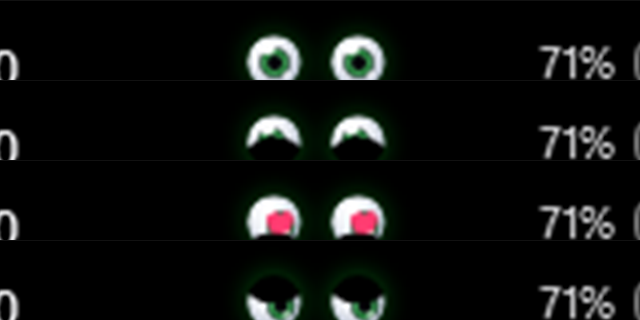
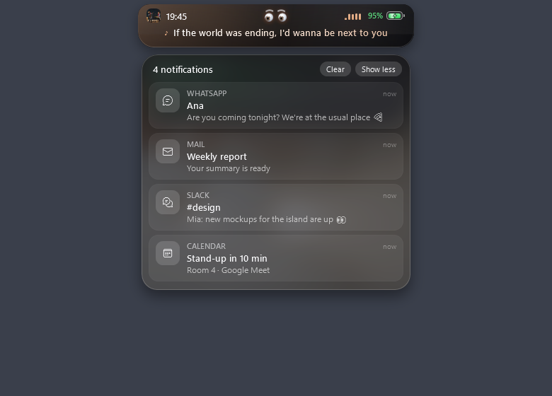
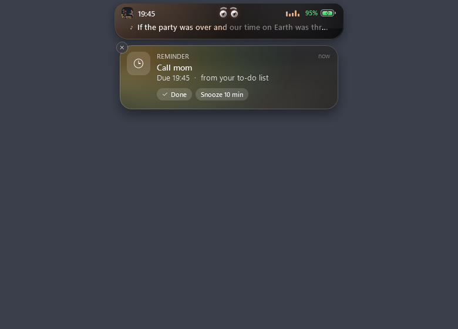
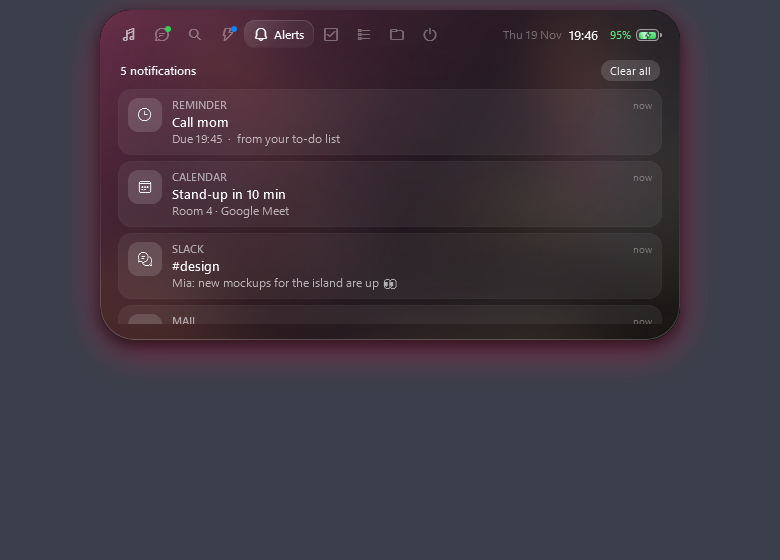
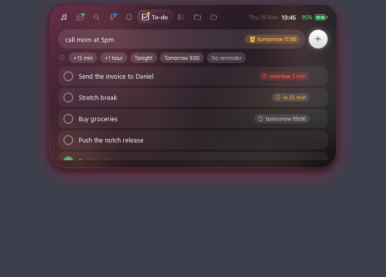
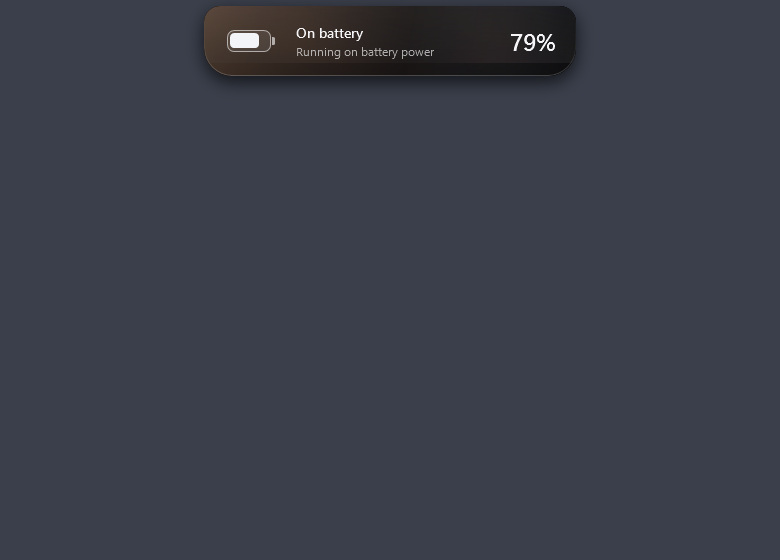
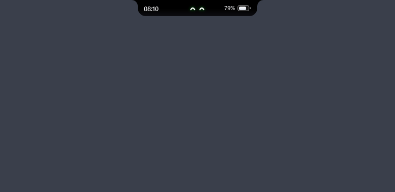

# Windows Notch

A Dynamic-Island-style notch for Windows 11: a small black pill at the top-center of the screen
that expands on hover into a control center.

## What it does

| State | Shows |
|---|---|
| **Idle (collapsed)** | Time · **living eyes** in the middle · battery (colour by level, green shimmer + bolt when charging) · green dot when the gesture camera is watching |
| **Media playing (collapsed)** | Artwork thumbnail · time · eyes bobbing to the music · animated equalizer bars tinted with the artwork colour · battery |
| **Volume / brightness** | The pill widens: icon + label, eyes in the middle, a glowing level bar + value |
| **Internet** | Wi-Fi / Ethernet name with happy eyes when connected; sad eyes and "No internet" when it drops |
| **Notification** | The eyes jump in surprise, then the pill opens with the app, title and message |
| **Lyrics / captions on** | A live line under the pill with the current lyric or caption |
| **Hover** | Expands after a short hover (the eyes hide); closes **3 s** after the mouse leaves |

### Chats and music search

- **Chats tab**: WhatsApp, Instagram, Telegram, Messenger… messages that arrive as notifications are collected per
  conversation. Hover a message pop-up to open it straight in the reply view. **Reply** types into the notification's
  own reply box, so it's sent by the app itself. If that notification is gone, the notch looks for it in Notification
  Center; otherwise it copies your reply and opens the app so you only paste it. (Only messages that arrive while the
  notch is running are shown; it can't read your chat history.)
- **Search tab, music inside the notch**: type a song or artist and YouTube results (thumbnail, title, channel, length)
  appear as you type. Click one, or press Enter for the first, and it **plays right in the notch**, with no browser. It uses
  YouTube's official embedded player in a hidden window and shows in the Media tab with artwork, progress, controls and
  karaoke lyrics, and the other results become "up next". Videos whose owners don't allow playback outside YouTube are
  skipped automatically. Click the source chip ("YouTube · notch") in the Media tab to stop it. Results come from
  YouTube's public search page (no API key), so a YouTube page change can break them until the notch is updated.
- **Activity tab**: Claude Code sessions (project, working / done, a summary of the latest reply, read from Claude Code's
  local session files on this PC), the Claude and ChatGPT desktop apps (responding… / reply finished) and VS Code (project
  · file, busy while building). While one works, the pill says "✦ Claude Code is working on …"; when it finishes, a
  pop-up shows the summary. Click a card to switch to that app.
- **Android**: same Chats view with **reply sent through WhatsApp / Instagram's own reply action**, and a Search view whose
  results **play inside the island** in the same way.

### The eyes

Little 3D eyes: shaded eyeballs, a coloured iris (it takes the artwork colour) that slides and foreshortens as they look
around, a fixed light reflection and real eyelids. They blink, glance around, follow your mouse near the top of the
screen and bob to the music. Play with them:

- **Hover** them and they stare back with bigger pupils and a blush; hovering the eyes doesn't open the notch.
- **Click** pokes them: they squeeze shut and wiggle. Poke four times quickly and they get **angry**.
- **Double-click** makes them **wink** with heart eyes.

Faces: happy (connected, max volume, device plugged in), surprised (notification, unplugged), hearts (charger plugged in),
sleepy (muted, very dim screen, battery ≤ 15 %) and sad (internet lost, device removed).



### The eyes talk

The eyes have expressive **eyebrows** (raised when surprised, tilted when sad or angry) and a sparkle that twinkles now and
then. They talk in little **speech bubbles** under the pill:

- **Hover** → "Hi! 👋", "Hello there!"…; **poke** → "Ouch!", "Boop! 👉", "That tickles 😆"; four quick pokes → "Stop it! 😤";
  **double-click** → "Hehe 😉".
- A time-of-day greeting when the notch starts, "Welcome back! 👋" when you unlock, "Yum, power ⚡" when you plug in,
  "Ooh, nice track 🎶", "On it! 💪" when work starts, "Done! ✅" when it finishes, "Battery's low 🥺".
- Every so often, while things are calm, a friendly nudge ("Stay hydrated 💧", "Time to stretch? 🧘").
- Turn it off with **Control → Eyes talk**.

### Notifications

Notifications are macOS-style **frosted banners** that drop out of the notch: a black droplet falls from the pill,
splats and blooms into a separate glass card floating just below it. The card shows the app's icon, its name, a bold
title and a two-line message. Hover it for the **✕** in its corner and the **Reply** / **Open <app>** buttons; while you
hover it never closes. Notifications that arrive together stack ("+2", with a card peeking out underneath). When it's
done, the card shrinks back into a droplet that rises into the notch.

With more than one waiting, the stack shows a **View all · N** badge. Click it and, like on an iPhone, the stack unfolds
into a scrolling frosted list: each card slides down out of the pile into its own place. **Show less** (or moving the
mouse away) folds it back up; **Clear** swipes them all away. Every notification is also kept in the **Alerts** tab,
even ones that arrive while the notch is open.

### To-do and reminders

The **To-do** tab is a quick task list with reminders. Type in plain words: "call mom at 5pm", "stretch in 20 min",
"pay rent tomorrow", "17:30 stand-up". The time is picked up and shown before you press Enter, or tap a chip
(+15 min, +1 hour, Tonight, Tomorrow 9:00). Due times are coloured (orange soon, red overdue). When a task is due, the
eyes jump and a reminder banner drops from the notch with **Done** and **Snooze 10 min**. It stays up for 20 seconds.
Tasks are saved in `%LOCALAPPDATA%\WindowsNotch\todo.json`.

| View all | Reminder | Alerts tab | To-do |
|---|---|---|---|
|  |  |  |  |

The frosted glass is a heavily blurred picture of what's behind the card, taken as it appears, so it works on any
Windows build. Windows' own blur draws a square box on some builds.

### The open notch floats

When it opens, the island lets go of the screen edge: it drops a little, rounds all four corners and sits on frosted
glass washed with the colours of whatever is playing.

### Standby clock

Windows' real lock screen runs on a protected desktop that no app can draw on, so the notch can't show there. Instead,
after 5 minutes away (or **Control → Standby clock**) it shows a macOS-lock-screen-style clock: your desktop heavily
blurred, the date and a big time, sleepy eyes and a frosted now-playing card. Move the mouse or press a key and it fades
away. It never covers a fullscreen video. Turn the automatic clock off with the switch next to the button.

**Privacy screen:** open it yourself any time with the lock button at the top of the open notch, **Control → Privacy
screen**, or **Ctrl+Alt+P** from anywhere. Opened this way it stays up when the mouse moves (so a bumped desk doesn't
reveal your screen); click or press any key to return. Ctrl+Alt+P again also closes it.

### Look

When small, the island is a little floating frosted capsule showing just the time, the eyes and battery %; when open it is dark smoked glass, with smooth rounded corners. Gradients are kept to a
minimum: flat colours, glass tiles and soft glows. (Windows' own blur can be tried with `"SystemBlur": true` in settings,
but some Windows builds draw it as a square box.)

### Plug-in animations

| Charger plugged in | Charger unplugged | USB / device |
|---|---|---|
|  |  |  |
| The battery fills, the bolt bursts in, green rings ripple and the % counts up | The bolt shrinks away, the level settles and the time left is shown | A cable slides in, the icon plugs in with a spark and a badge shows the type (drive, phone, audio, keyboard, mouse, camera…). Removing it slides the icon out |

| Idle | Happy | Volume | Wi-Fi | Notification |
|---|---|---|---|---|
|  |  |  |  |  |

Running jobs (Claude Code, terminal builds…) are listed in the **Activity** tab. They only show in the small pill if
you turn on **Show in pill** there.

Expanded tabs:

- **Media**: big artwork, title/artist, seekable progress bar, previous/play/next. Click the source chip to switch between Chrome, Spotify, VLC and so on. **Lyrics** shows time-synced lyrics (automatic for Spotify, from LRCLIB). **CC** shows live captions for YouTube, Chrome or any audio, using Windows 11 Live Captions with its window hidden.
- **Apps**: every open window (VS Code, VLC, Terminal, Chrome…). Click to switch to it; hover and press ✕ to close it.
- **Shelf**: drag files, folders or text onto the notch to keep them. Double-click to open, drag out to use, right-click to show in Explorer. Saved between restarts.
- **Control**: Lock · Sleep · Restart · Shut down, the hand-gesture switch, clap control, and Start with Windows.

### The eyes speak 🔊

Control → **Voice** makes the eyes say their speech bubbles out loud: greetings, reactions to pokes, nudges, charger
messages. **Four claps 👏👏👏👏** switch the voice on or off (with Claps on), and it tells you so.

- Click the voice chip to paste an **ElevenLabs API key** (it starts with `sk_`) and a voice ID; **Test** plays a sample.
  The key is stored encrypted for your Windows account on this PC only. It's never put in the code or the releases.
- Without a key, the notch uses the voice built into Windows.
- Each phrase is made once and kept in `%APPDATA%\WindowsNotch\voice`, so the usual lines use ElevenLabs credits only the first time.
- It stays quiet while music plays, so it never talks over your song.

### Lyrics on the lock screen

When a song with synced lyrics plays, the big-clock lock / privacy screen shows the lyrics in the middle: the line being
sung large and glowing, with the lines before and after dimmed. They move along with the song.
### Camera hand gestures

| Gesture (hand **close** to the camera, held ~1 s) | Action |
|---|---|
| ✊ Closed fist | **Lock** the PC |
| 🖐 Open palm | **Restart**, after a 5-second countdown you can cancel |
| ✊ during a countdown | **Cancel** the restart / shutdown |

- **Camera preview** (Control → Hand gestures → *Camera preview*): a small always-on-top window with the live camera,
  the tracked hand skeleton, the recognised gesture and a "move closer" meter. Close it any time; gestures keep working.
  The camera image is never saved or sent anywhere.
- "Near the camera only": the hand has to fill about 30 % of the frame (`MinHandSize`), so people in the background are ignored.
- The camera is released while the PC is locked, and gestures are never acted on from the lock screen.

**Two gesture engines.** The notch picks one automatically:

| Engine | Used when | Notes |
|---|---|---|
| **Python** (recommended) | Python 3.9–3.12 with `opencv-python` + `mediapipe` installed | Reads the camera through DirectShow, cleans the picture (stripe removal, denoise, exposure fix) before detection. Best for cheap or noisy webcams. |
| Built-in | otherwise | MediaPipe in a hidden WebView2. Nothing to install. |

Install the Python engine's packages once:

```bash
py -3.12 -m pip install -r python/requirements.txt
```

Check your camera's picture quality with `python python/camera_probe.py` (lower `stripes` / `colnoise` is better).

### Clap control (no camera needed)

For PCs whose camera can't see hands well: Control → Gestures & claps → **Claps 👏** listens with the microphone.
It works on its own, or together with the camera gestures. Switch on either one, or both.

| Claps | Action |
|---|---|
| 👏👏 Two claps | **Lock** the PC |
| 👏👏👏 Three claps | **Restart**, after the countdown you can cancel |
| 👏👏 during a countdown | **Cancel** the restart / shutdown |

- Clap in a steady rhythm, about half a second apart. The pill shows each clap it hears.
- Ignored while your hands are on the keyboard or mouse (so typing never locks the PC), while music or a video plays,
  for a few seconds after unlocking, and on the lock screen. The microphone is released while the PC is locked.
- Talking, knocks, music and applause (four or more claps) don't count. Sound is analysed live and never recorded.
- Needs **Settings → Privacy → Microphone → "Let desktop apps access your microphone"**.

## Download

Grab `WindowsNotch-v*-win-x64.zip` from the [Releases](../../releases) page, unzip it anywhere and run `WindowsNotch.exe`.
It's self-contained: no .NET install needed.

### Automatic updates

The notch keeps itself up to date. 90 seconds after it starts (then every 6 hours) it looks for a newer release on
GitHub, downloads it, and checks it against the SHA-256 fingerprint GitHub publishes for that file. A banner says
**Update ready** with an **Update now** button; otherwise it installs by itself the next time you're away (3 minutes
idle, nothing playing): the island retracts, the new files are copied in, and it comes back on the new version with an
**Updated to vX ✨** banner. Your settings, shelf and to-dos are kept.

**Control → Auto-update** turns the automatic part off; the chip next to it shows your version and checks or installs on
click. A copy that can't replace its own files (in a protected folder like Program Files, or a developer build) just
tells you a new version is out and links to the download.

## Android: Notch Island

The same island for Android phones (Android 8+), in [`android/`](android): a pill around your front camera hole with
the 3D eyes, the droplet launch intro, now-playing media (artwork, progress, controls, karaoke lyrics from LRCLIB),
notification pop-ups with the app's icon, and charging / volume animations.

**Install:** download `NotchIsland-v*.apk` from [Releases](../../releases) and open it on your phone (allow installing
from your browser or file manager when asked). Then open **Notch Island** and:

1. **Turn on the island**: Settings → Accessibility → Notch Island → On. It only draws the island and doesn't read your
   screen. On Android 13+ a sideloaded app's accessibility switch is greyed out at first. Open *App info → ⋮ →
   Allow restricted settings* and try again.
2. **Allow media & notifications**: Notification access → Notch Island → On.

Tap the island to open it, tap outside to close it. Tap the big eyes in the open view to poke them, or double-tap them to wink.

The small pill shows the time, the eyes and battery %, on smoked glass tinted with the colour of what's playing. While
music plays the eyes step aside for the artwork and equaliser, and the current lyric line runs under the pill.

- **Alerts**: every notification is kept here. When several arrive together the pop-up shows **View all · N**; tap it
  and the stack unfolds into a list, card by card, like on an iPhone. **Clear all** swipes them away.
- **To-do**: type tasks in plain words ("call mom at 5pm", "stretch in 20 min", "pay rent tomorrow") or tap a quick
  time. When one is due, the eyes jump and a ringing reminder drops from the island with **Done** and **Snooze 10 min**.
- **Search**: YouTube songs play right inside the island.
- **Clap control 👏** (switch on the setup screen): clap twice to **lock the phone**, three times to open the **power
  menu**. Android doesn't let apps restart the phone, so that step is yours. It uses the microphone (you're asked
  once) and shows a small "Listening for claps" notification. Claps are ignored while music plays, during calls and
  when the phone is locked. Nothing is recorded.

Build it yourself with JDK 17 and the Android SDK (platform 35): `cd android` then `gradlew assembleRelease`.

## iPhone: Notch Island for iOS

The island for iPhone (iOS 16.2+), in [`ios/`](ios). It lives in your **Dynamic Island**: when you leave the app, the
eyes and battery stay up top. Long-press it to see what's playing and your next to-do with a live countdown (also shown on
the lock screen).

- In the app, the island is a pill with the time, the eyes and battery, and the lyric line while music plays. Tap it for:
  - **Music**: what's playing in the Music app, with controls and synced lyrics from LRCLIB.
  - **To-do**: tasks with reminders, which arrive as normal iPhone notifications.
  - **Control**: the privacy screen, clap control, the Dynamic Island switch and Eyes talk.
- **Clap control 👏**: clap twice for the **privacy screen** (and twice again to leave it). Clap three times to
  **play/pause** music.
- **Privacy screen**: a big clock over a blur.

What iOS doesn't allow, so the iPhone version can't do it:
- lock or restart the phone (so claps work only while the app is open);
- read other apps' notifications;
- see what Spotify or YouTube are playing (only the Music app);
- draw over other apps (the Dynamic Island is the way to stay on screen).

**Install:** download `NotchIsland-iOS-v*-unsigned.ipa` from [Releases](../../releases) and install it with
[AltStore](https://altstore.io) or [Sideloadly](https://sideloadly.io), which sign it with your own Apple ID. With a free
Apple ID the app has to be refreshed every 7 days.

The `.ipa` is built on GitHub's Mac runners by [`.github/workflows/ios.yml`](.github/workflows/ios.yml). To build it
yourself on a Mac: `brew install xcodegen`, then `cd ios && xcodegen generate`, and open `NotchIsland.xcodeproj`.

## Build from source

```bash
dotnet build -c Release
```

Then start `bin\Release\net8.0-windows10.0.19041.0\WindowsNotch.exe`. Use **Control → Start with Windows** to have it start at sign-in.

Requirements: Windows 10 2004+ (Windows 11 22H2+ for captions), .NET 8 runtime, and the WebView2 runtime, which comes with Windows 11.
Gestures need **Settings → Privacy → Camera → "Let desktop apps access your camera"** turned on, plus internet the first
time to download the MediaPipe model (about 8 MB, cached afterwards). Captions: if nothing appears, press **Win + Ctrl + L** once to finish Live Captions setup.

## Settings

`%APPDATA%\WindowsNotch\settings.json`:

```json
{
  "GesturesEnabled": true,
  "ClapsEnabled": false,       // clap control through the microphone
  "MinHandSize": 0.30,          // raise to require the hand even closer
  "HoldMs": 900,                // how long to hold a gesture
  "PowerCountdownSec": 5,
  "CollapseDelaySec": 3,
  "LyricsEnabled": true,
  "CaptionsEnabled": false,
  "HideInFullscreen": true      // fades out over fullscreen video (still opens on hover)
}
```

Logs, including each gesture that fired: `%APPDATA%\WindowsNotch\notch.log`.

## Known limits

- **It can't appear on the lock screen.** Windows draws the lock and PIN screen on a separate secure desktop that normal apps aren't allowed to draw on. Only Windows itself or a signed credential provider can. The notch is back as soon as you unlock.
- Media info comes from Windows' media controls. VLC 3.x doesn't report there (VLC 4 does), but VLC still shows in **Apps**.
- Lyrics depend on LRCLIB having the song. Spotify doesn't offer a public lyrics API.
