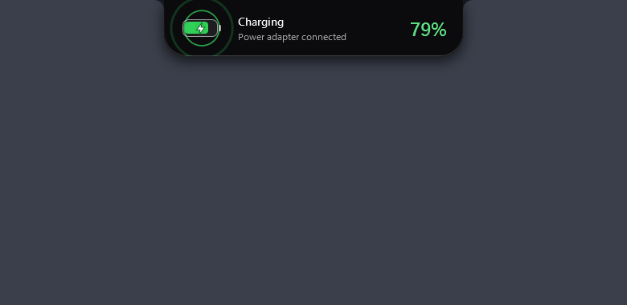
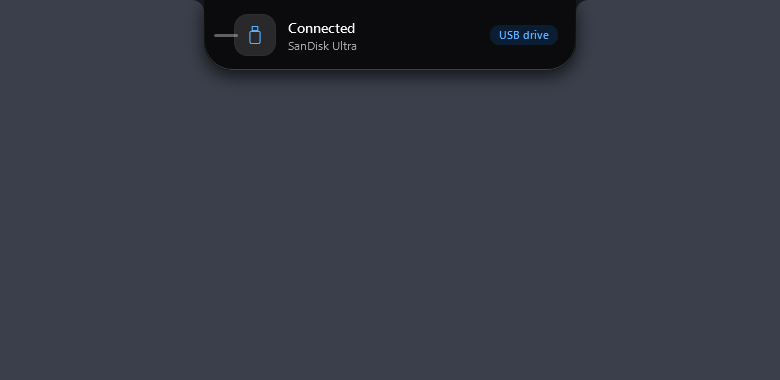
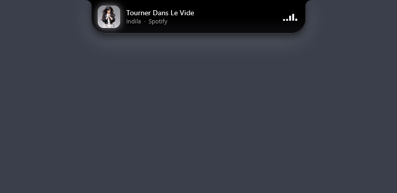
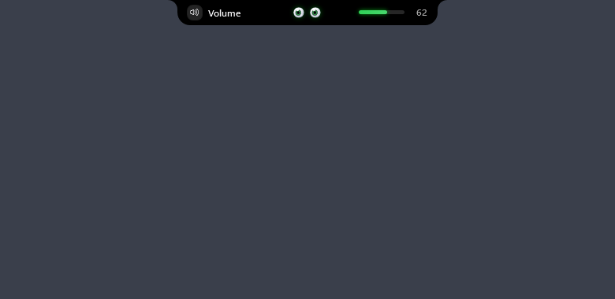
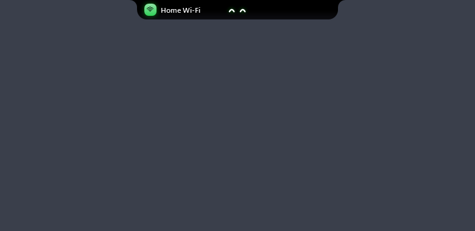
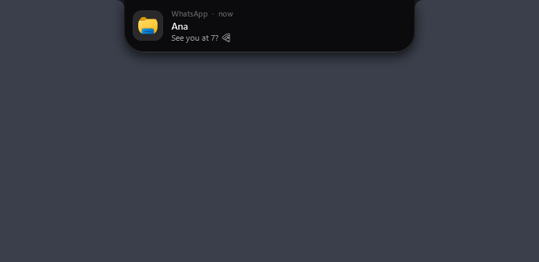

# Windows Notch

A Dynamic-Island-style notch for Windows 11: a small black pill at the top-center of the screen
that expands on hover into a control center.

## What it does

| State | Shows |
|---|---|
| **Idle (collapsed)** | Time · **living eyes** in the middle · battery (colour by level, green shimmer + bolt when charging) · green dot when the gesture camera is watching |
| **Media playing (collapsed)** | Artwork thumbnail · time · eyes bobbing to the music · animated equalizer bars tinted with the artwork colour · battery |
| **Volume / brightness** | The pill widens: icon + label, eyes in the middle, a glowing level bar + value |
| **Internet** | Wi-Fi / Ethernet name with happy eyes when connected; sad eyes and "No internet" when it drops |
| **Notification** | The eyes jump in surprise, then the pill opens with the app, title and message |
| **Lyrics / captions on** | A live line under the pill with the current lyric or caption |
| **Hover** | Expands after a short hover (the eyes hide); closes **3 s** after the mouse leaves |

### Chats and music search

- **Chats tab**: WhatsApp, Instagram, Telegram, Messenger… messages that arrive as notifications are collected per
  conversation. Hover a message pop-up to open it straight in the reply view. **Reply** types into the notification's
  own reply box, so it's sent by the app itself. If that notification is gone, the notch looks for it in Notification
  Center; otherwise it copies your reply and opens the app so you only paste it. (Only messages that arrive while the
  notch is running are shown; it can't read your chat history.)
- **Search tab**: type a song or artist and YouTube's suggestions appear as you type. Click one to open it on YouTube, or
  **YT Music** to open it on YouTube Music. Enter opens YouTube; Shift+Enter opens YouTube Music.
- **Android**: same Chats view with **reply sent through WhatsApp / Instagram's own reply action**, plus a Search view
  where **Play** starts the top result in YouTube Music (or opens YouTube if it isn't installed).

### The eyes

Little 3D eyes: shaded eyeballs, a coloured iris (it takes the artwork colour) that slides and foreshortens as they look
around, a fixed light reflection and real eyelids. They blink, glance around, follow your mouse near the top of the
screen and bob to the music. Play with them:

- **Hover** them and they stare back with bigger pupils and a blush; hovering the eyes doesn't open the notch.
- **Click** pokes them: they squeeze shut and wiggle. Poke four times quickly and they get **angry**.
- **Double-click** makes them **wink** with heart eyes.

Faces: happy (connected, max volume, device plugged in), surprised (notification, unplugged), hearts (charger plugged in),
sleepy (muted, very dim screen, battery ≤ 15 %) and sad (internet lost, device removed).


### Look

The island is solid black while small and dark smoked glass when open, with smooth rounded corners. Gradients are kept to a
minimum: flat colours, glass tiles and soft glows. (Windows' own blur can be tried with `"SystemBlur": true` in settings,
but some Windows builds draw it as a square box.)

### Plug-in animations

| Charger plugged in | Charger unplugged | USB / device |
|---|---|---|
|  |  |  |
| The battery fills, the bolt bursts in, green rings ripple and the % counts up | The bolt shrinks away, the level settles and the time left is shown | A cable slides in, the icon plugs in with a spark and a badge shows the type (drive, phone, audio, keyboard, mouse, camera…). Removing it slides the icon out |

| Idle | Happy | Volume | Wi-Fi | Notification |
|---|---|---|---|---|
|  |  |  |  |  |

Expanded tabs:

- **Media**: big artwork, title/artist, seekable progress bar, previous/play/next. Click the source chip to switch between Chrome, Spotify, VLC and so on. **Lyrics** shows time-synced lyrics (automatic for Spotify, from LRCLIB). **CC** shows live captions for YouTube, Chrome or any audio, using Windows 11 Live Captions with its window hidden.
- **Apps**: every open window (VS Code, VLC, Terminal, Chrome…). Click to switch to it; hover and press ✕ to close it.
- **Shelf**: drag files, folders or text onto the notch to keep them. Double-click to open, drag out to use, right-click to show in Explorer. Saved between restarts.
- **Control**: Lock · Sleep · Restart · Shut down, the hand-gesture switch, and Start with Windows.

### Camera hand gestures

| Gesture (hand **close** to the camera, held ~1 s) | Action |
|---|---|
| ✊ Closed fist | **Lock** the PC |
| 🖐 Open palm | **Restart**, after a 5-second countdown you can cancel |
| ✊ during a countdown | **Cancel** the restart / shutdown |

- **Camera preview** (Control → Hand gestures → *Camera preview*): a small always-on-top window with the live camera,
  the tracked hand skeleton, the recognised gesture and a "move closer" meter. Close it any time; gestures keep working.
  The camera image is never saved or sent anywhere.
- "Near the camera only": the hand has to fill about 30 % of the frame (`MinHandSize`), so people in the background are ignored.
- The camera is released while the PC is locked, and gestures are never acted on from the lock screen.

**Two gesture engines.** The notch picks one automatically:

| Engine | Used when | Notes |
|---|---|---|
| **Python** (recommended) | Python 3.9–3.12 with `opencv-python` + `mediapipe` installed | Reads the camera through DirectShow, cleans the picture (stripe removal, denoise, exposure fix) before detection. Best for cheap or noisy webcams. |
| Built-in | otherwise | MediaPipe in a hidden WebView2. Nothing to install. |

Install the Python engine's packages once:

```bash
py -3.12 -m pip install -r python/requirements.txt
```

Check your camera's picture quality with `python python/camera_probe.py` (lower `stripes` / `colnoise` is better).

## Download

Grab `WindowsNotch-v*-win-x64.zip` from the [Releases](../../releases) page, unzip it anywhere and run `WindowsNotch.exe`.
It's self-contained: no .NET install needed.

## Android: Notch Island

The same island for Android phones (Android 8+), in [`android/`](android): a pill around your front camera hole with
the 3D eyes, the droplet launch intro, now-playing media (artwork, progress, controls, karaoke lyrics from LRCLIB),
notification pop-ups with the app's icon, and charging / volume animations.

**Install:** download `NotchIsland-v*.apk` from [Releases](../../releases) and open it on your phone (allow installing
from your browser or file manager when asked). Then open **Notch Island** and:

1. **Turn on the island**: Settings → Accessibility → Notch Island → On. It only draws the island and doesn't read your
   screen. On Android 13+ a sideloaded app's accessibility switch is greyed out at first. Open *App info → ⋮ →
   Allow restricted settings* and try again.
2. **Allow media & notifications**: Notification access → Notch Island → On.

Tap the island to open it, tap outside to close it. Tap the big eyes in the open view to poke them, or double-tap them to wink.

Build it yourself with JDK 17 and the Android SDK (platform 35): `cd android` then `gradlew assembleRelease`.

## Build from source

```bash
dotnet build -c Release
```

Then start `bin\Release\net8.0-windows10.0.19041.0\WindowsNotch.exe`. Use **Control → Start with Windows** to have it start at sign-in.

Requirements: Windows 10 2004+ (Windows 11 22H2+ for captions), .NET 8 runtime, and the WebView2 runtime, which comes with Windows 11.
Gestures need **Settings → Privacy → Camera → "Let desktop apps access your camera"** turned on, plus internet the first
time to download the MediaPipe model (about 8 MB, cached afterwards). Captions: if nothing appears, press **Win + Ctrl + L** once to finish Live Captions setup.

## Settings

`%APPDATA%\WindowsNotch\settings.json`:

```json
{
  "GesturesEnabled": true,
  "MinHandSize": 0.30,          // raise to require the hand even closer
  "HoldMs": 900,                // how long to hold a gesture
  "PowerCountdownSec": 5,
  "CollapseDelaySec": 3,
  "LyricsEnabled": true,
  "CaptionsEnabled": false,
  "HideInFullscreen": true      // fades out over fullscreen video (still opens on hover)
}
```

Logs, including each gesture that fired: `%APPDATA%\WindowsNotch\notch.log`.

## Known limits

- **It can't appear on the lock screen.** Windows draws the lock and PIN screen on a separate secure desktop that normal apps aren't allowed to draw on. Only Windows itself or a signed credential provider can. The notch is back as soon as you unlock.
- Media info comes from Windows' media controls. VLC 3.x doesn't report there (VLC 4 does), but VLC still shows in **Apps**.
- Lyrics depend on LRCLIB having the song. Spotify doesn't offer a public lyrics API.
